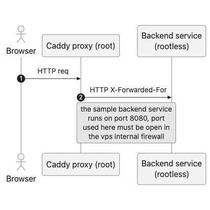

# mdd-php-stub

Minimal PHP page served by nginx with PHP-FPM, built and deployed by GitHub Actions.



## Run locally

```sh
docker compose up --build
curl http://localhost:8080
```

## Deploy

### From your machine

```sh
./deploy.sh              # rsync the tree to the server
./deploy.sh --build      # ...then build and restart the container
./deploy.sh --dry-run    # show what would change
./deploy.sh --prune      # also delete files removed locally
```

Defaults match the old `scp -i ~/.ssh/id_mdd_linode -r * preview@mdd-production:/home/preview/workbench/`
deploy; override with `SSH_KEY`, `SSH_PORT`, `DEPLOY_USER`, `DEPLOY_HOST`, `DEPLOY_PATH`, `APP_PORT`.
`.git`, `.github` and `.DS_Store` are skipped, everything else (including dotfiles) is synced.

### From CI

Push to `main` (or run the workflow manually):

1. Copy the checked-out commit to the server over SSH (`tar`, `.git` excluded).
2. Build the image on the server, `docker compose up -d --build`.
3. Ensure the ufw rule that lets Caddy reach `APP_PORT` (see below).
4. `docker image prune -af`.

No registry is involved: the image is built and kept on the server only, and nothing is pushed anywhere.

### Firewall

Builds keep this rule in place, so Caddy can reach the published port across the
Docker bridge even with ufw's default forwarding policy:

```sh
sudo ufw allow from 172.16.0.0/12 to any port 8080 proto tcp \
  comment 'Allow Caddy to reach rootless preview app'
```

It is idempotent (a repeat run reports the rule exists and exits 0) and follows
`APP_PORT`, so a different port gets its own rule. If `ufw` is not installed the
step skips with a warning; on any other failure the deploy fails.

### Secrets

| Secret | Value |
| --- | --- |
| `SSH_HOST` | Server hostname or IP |
| `SSH_USER` | SSH user with Docker access |
| `SSH_KEY` | Private key |
| `SSH_PORT` | Optional, default `22` |
| `DEPLOY_PATH` | Absolute target directory on server |

Variable: `APP_PORT` (host port, default `8080`).

## Caveats

- The server needs Docker with the Compose plugin and outbound access to Docker Hub for the `php:8.3-fpm` base image.
- The build happens on the server, so the first deploy is slower; later deploys reuse the server's build cache. Only the previous image is pruned, not the cache.
- The firewall step runs `sudo -n ufw`, so the deploy user needs passwordless sudo for `ufw`; without it the deploy fails rather than silently leaving the app unreachable.
- Files are copied over the top of `DEPLOY_PATH`; files deleted from the repo are not removed from the server. Delete them by hand if that matters.
- The deploy needs the whole tree, including `etc/`, in `DEPLOY_PATH`. Copying only the top-level files (e.g. by hand with `scp *.yml *.php`) breaks the build with `failed to compute cache key: "/etc/supervisord.conf": not found`.
- `docker image prune -af` removes all images unused by running containers on that daemon.
